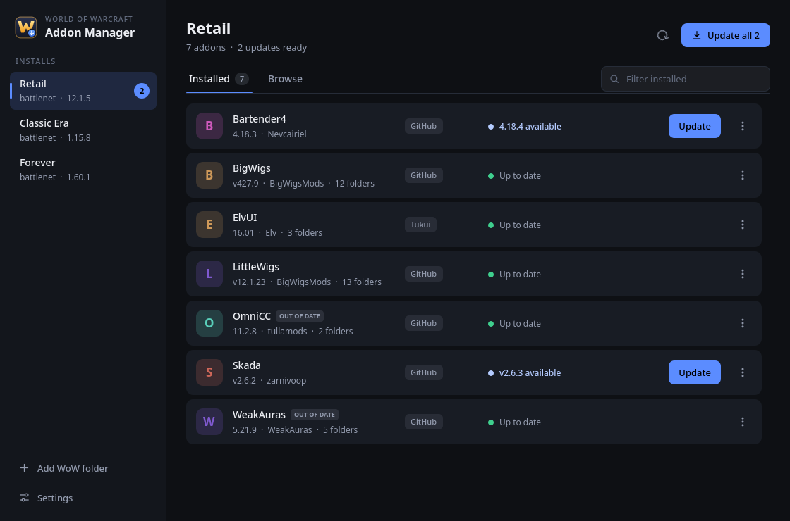
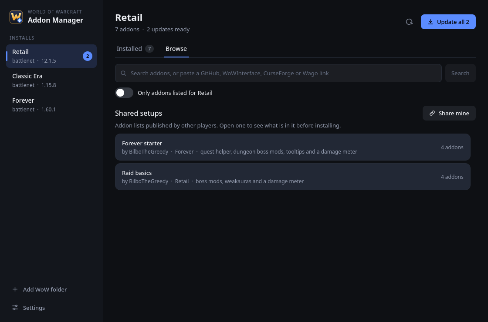
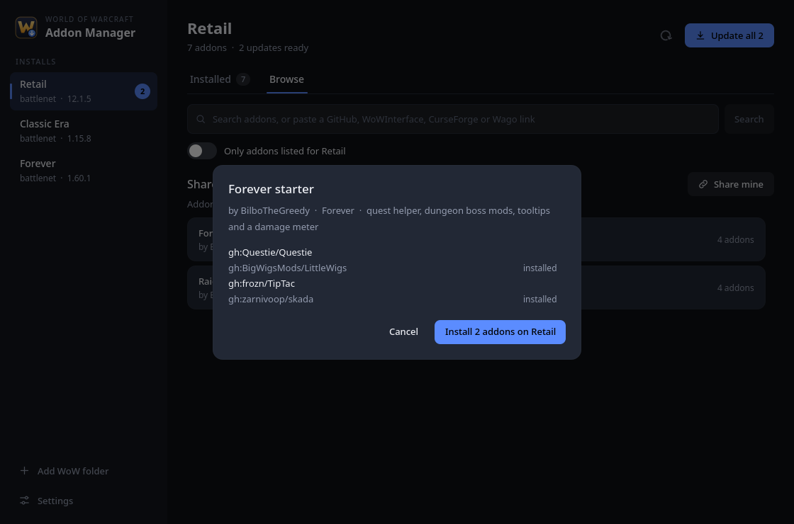
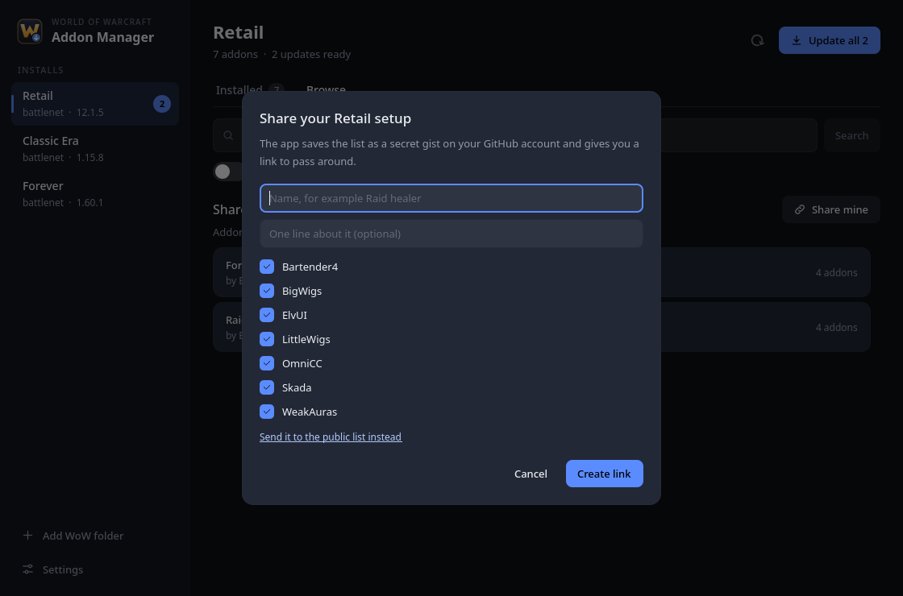
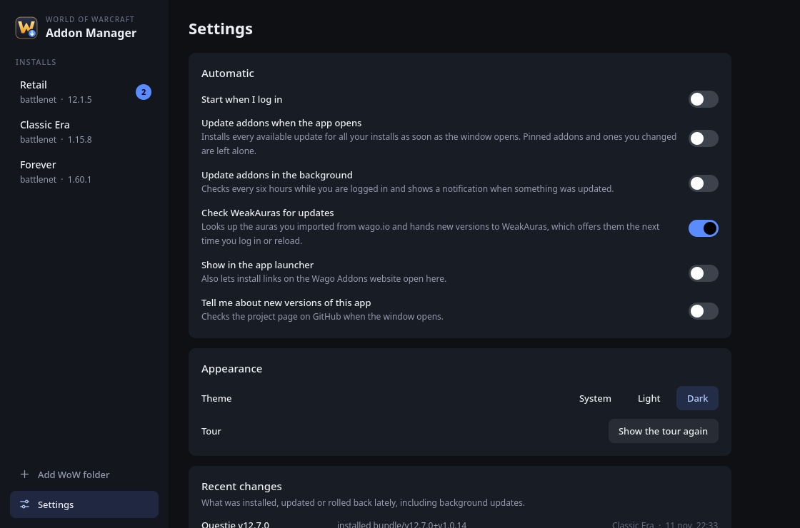

# World of Warcraft addon manager (wowam)

A free addon manager with a real GUI for Linux, Windows and macOS. Works with Retail, Classic and Forever.



- finds your WoW installs on its own, also under Lutris, Steam and Wine
- installs and updates addons from GitHub, WoWInterface and Tukui with no account or key
- **share a whole addon setup with one link**, or install somebody else's
- changelogs, pin a version, go back to the previous one
- backs up your settings before it updates anything
- keeps WeakAuras from wago.io up to date
- tray icon, start at login, background updates, updates itself
- no ads, no account, no tracking

## Install

**Windows**: download `wowam-setup.exe` from [Releases](https://github.com/BilboTheGreedy/wowam/releases/latest) and run it. Windows may warn that the installer is not signed, choose "More info" and "Run anyway".

**Linux**:

```
curl -fsSL https://raw.githubusercontent.com/BilboTheGreedy/wowam/main/install.sh | sh
```

**macOS**: download `wowam-macos.zip` from [Releases](https://github.com/BilboTheGreedy/wowam/releases/latest), unzip it and move the app to Applications. The first time, right click it and choose Open.

**From source**: `./run` (needs python 3.11+ and pyside6).

## Getting started

1. Open the app. Your WoW installs show up on the left. If one is missing, use "Add WoW folder".
2. Pick an install. The Installed tab lists its addons and finds where each one comes from.
3. Press "Update all" when there are updates.
4. Open Browse to add more. Search by name or paste an addon link.
5. Have a look in Settings for backups, start at login and the tray icon.

There is a short tour the first time you start the app.

## Shared addon setups

Install someone's whole addon setup in one click, or share your own with a link.



**Install a setup**

- Open Browse. Shared setups are listed there. Click one to see what is in it, then install.
- Or paste a link somebody sent you into the search box.



**Share yours**

- Click "Share mine" in Browse, give the setup a name and pick the addons. The app saves it as a secret gist on your GitHub account and copies the link. Send the link to your friends, they paste it into Browse.
- Sharing again from the same install updates the same link.
- It needs a GitHub token with the gist permission (Settings), or being signed in with the GitHub CLI (`gh auth login`).
- To get it listed in the app for everyone, use "Send it to the public list instead". That opens a pull request on [wowam-lists](https://github.com/BilboTheGreedy/wowam-lists).



A list is just a text file, so you can also write one by hand and put it in a gist or a repo:

```
# name: Raid basics
# by: yourname
# for: Retail
# about: boss mods and a damage meter
gh:BigWigsMods/BigWigs
https://github.com/WeakAuras/WeakAuras2
wowi:12345
```

The same list works on any WoW version, the app picks the right files for the install you put it on.

## More

Everything else is explained in the [guide](docs/guide.md): addon sources and keys, pinning and going back a version, backups, WeakAuras updates, the tray, the command line and where files are kept.



## Questions

**Where do the addons come from?** GitHub, WoWInterface and Tukui work out of the box. Wago Addons and CurseForge work when you add your own key in Settings.

**Does it touch my settings?** It only changes the AddOns folder. Before an update it makes a backup of the WTF folder, where the game keeps your settings.

**An addon I want is only on CurseForge.** Check if the author also has it on GitHub, most do. Paste that link into Browse.

**Something is broken.** Open an [issue](https://github.com/BilboTheGreedy/wowam/issues).

MIT license.
